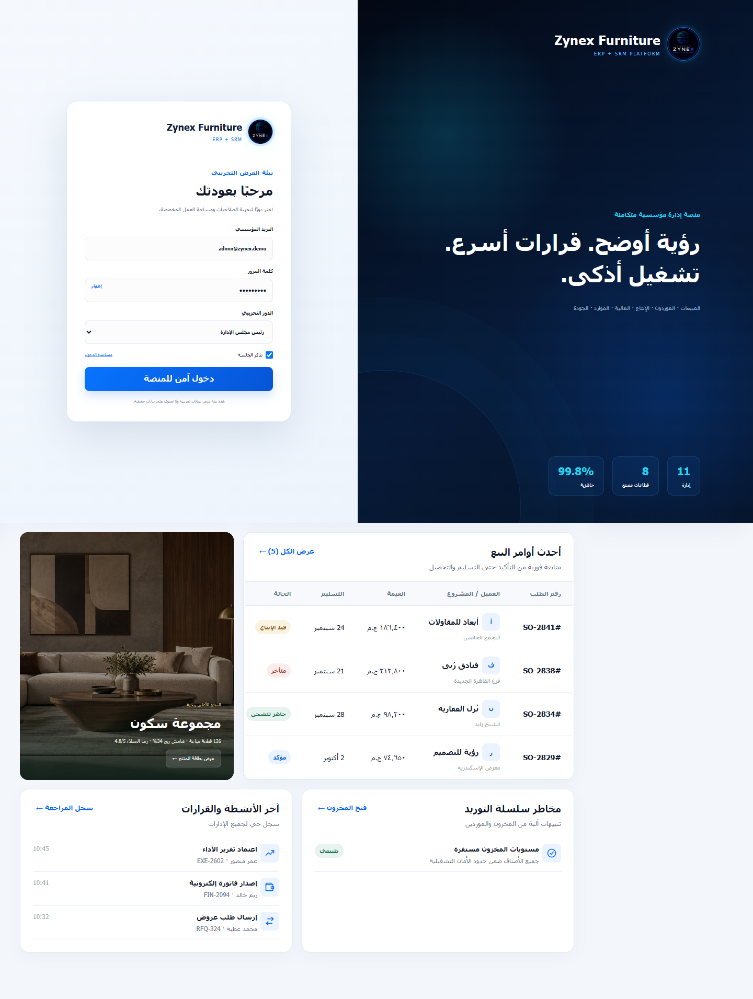
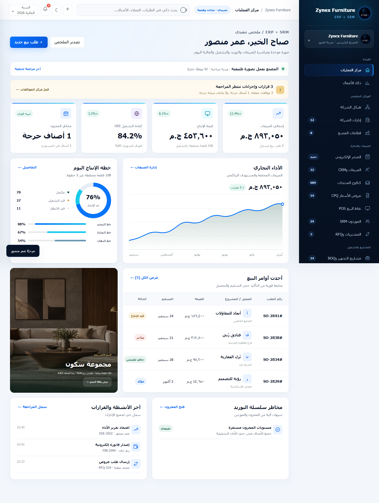
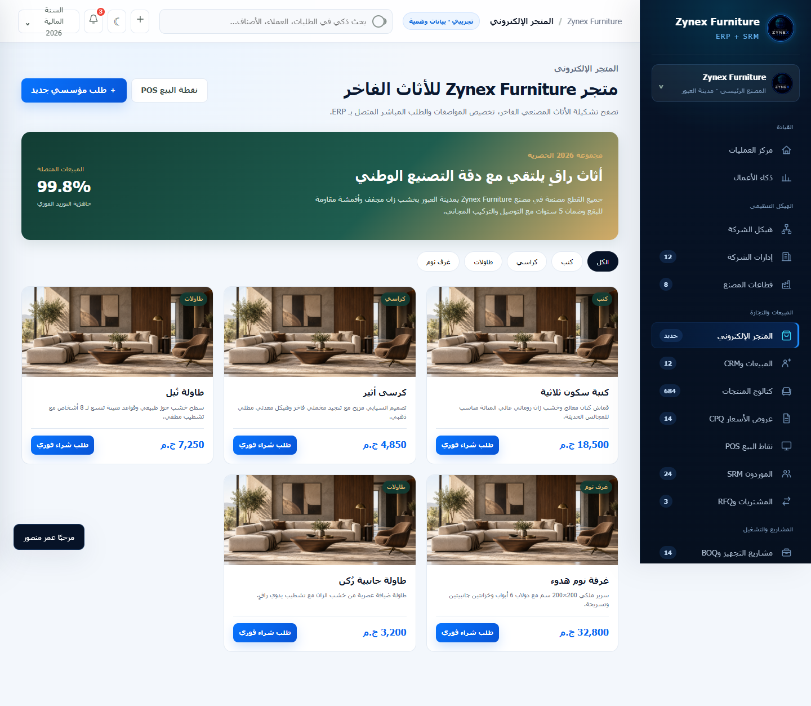
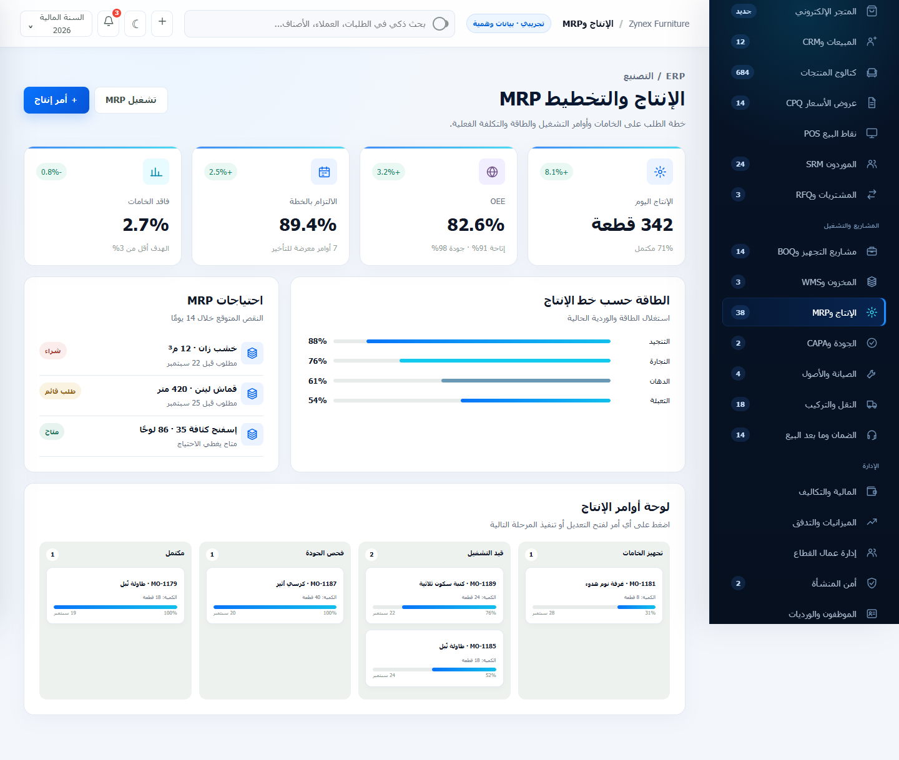

# Zynex Furniture

منصة مؤسسية عربية متكاملة لإدارة تجارة وتصنيع الأثاث، تجمع عمليات ERP وSRM في تجربة واحدة متجاوبة وسهلة الاستخدام.

> هذا المستودع مخصص لعرض المشروع فقط. الكود المصدري محفوظ في مستودع خاص.

## نظرة عامة

تربط Zynex Furniture بين المبيعات والعملاء والموردين والمشتريات والمخزون والإنتاج والجودة والمالية والفروع، مع لوحات متابعة تنفيذية وصلاحيات مخصصة لكل دور داخل المؤسسة.

## المميزات الرئيسية

- لوحة قيادة تنفيذية ومؤشرات أداء لحظية.
- متجر إلكتروني للأثاث مرتبط بعمليات المؤسسة.
- إدارة المبيعات والعملاء CRM وعروض الأسعار CPQ.
- نقاط البيع POS وإدارة الفواتير والمدفوعات.
- إدارة الموردين SRM والمشتريات وطلبات RFQ.
- إدارة المخزون والمستودعات WMS.
- تخطيط الإنتاج والمواد MRP ومتابعة أوامر التشغيل.
- إدارة الجودة CAPA والصيانة والأصول.
- إدارة النقل والتركيب وخدمات ما بعد البيع.
- الإدارة المالية والميزانيات والرواتب والحضور.
- إدارة الفروع والمعارض والموظفين.
- بوابات منفصلة للعملاء والموردين.
- موافقات ومراجعة وصلاحيات مبنية على الأدوار.
- واجهة عربية RTL متجاوبة مع الكمبيوتر والهاتف.

## صور المشروع

### تسجيل الدخول

### مركز العمليات

### المتجر الإلكتروني

### الإنتاج والتخطيط MRP

## التقنيات المستخدمة

- Node.js
- Vanilla JavaScript
- HTML5
- CSS3
- REST API
- JSON data storage
- Progressive Web App (PWA)
- Role-Based Access Control (RBAC)
- Node.js integration testing

## الأمان والاعتمادية

- مصادقة بجلسات موقعة وصلاحيات منفصلة لكل دور.
- تحقق من البيانات ومعالجة مركزية للأخطاء.
- تحديد معدل الطلبات وسياسات CORS وحماية HTTP.
- اختبارات تكامل للـAPI وتدفقات الصلاحيات.
- بيانات العرض تجريبية ولا تحتوي على بيانات عملاء حقيقية.

## فريق التطوير

تم تصميم وتطوير المشروع بواسطة **Zynex Team**.

© 2026 Zynex Team. All rights reserved.
